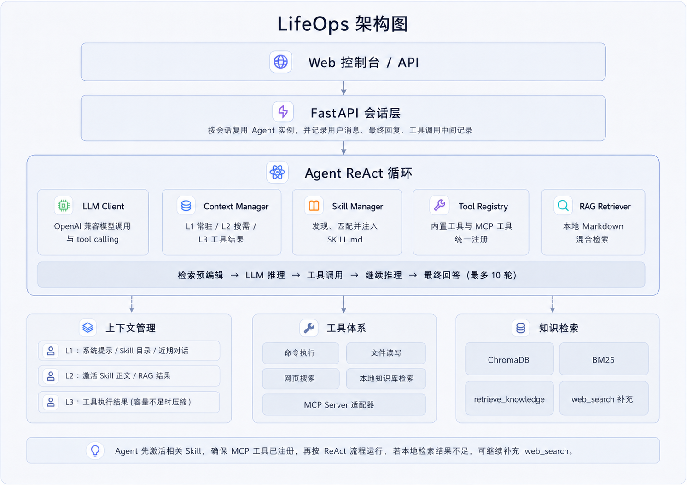
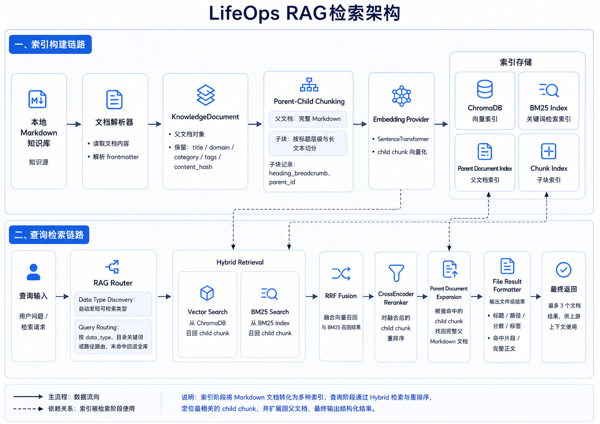
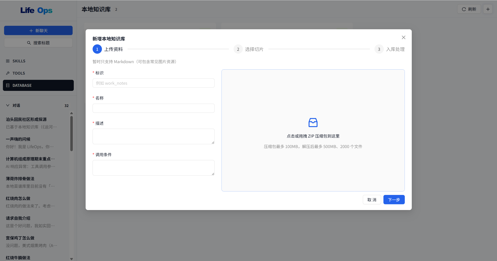
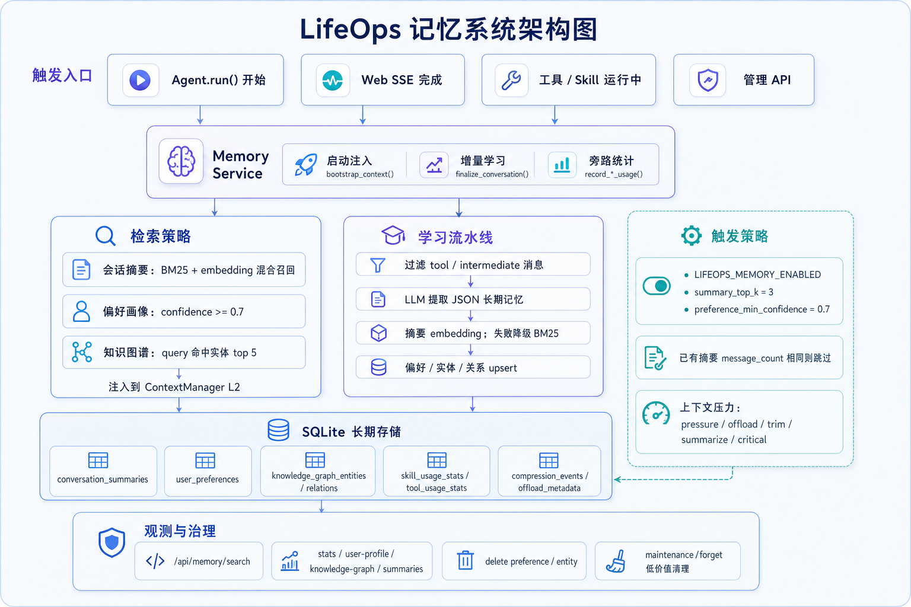
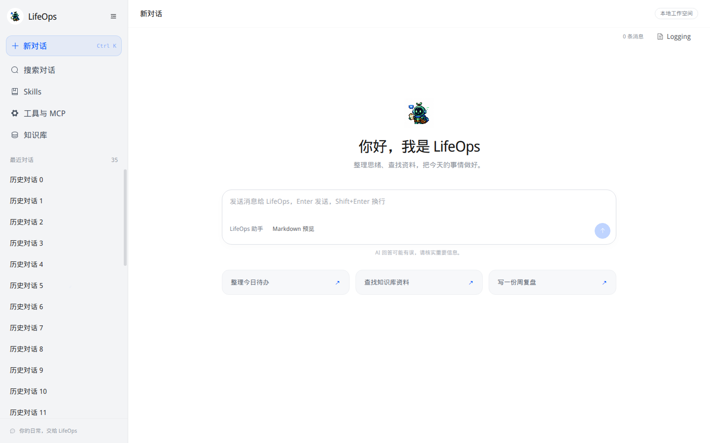
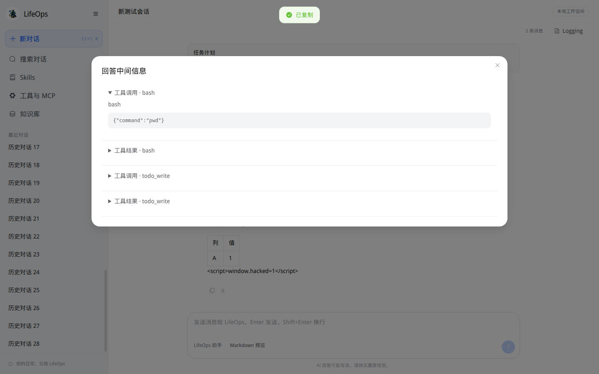
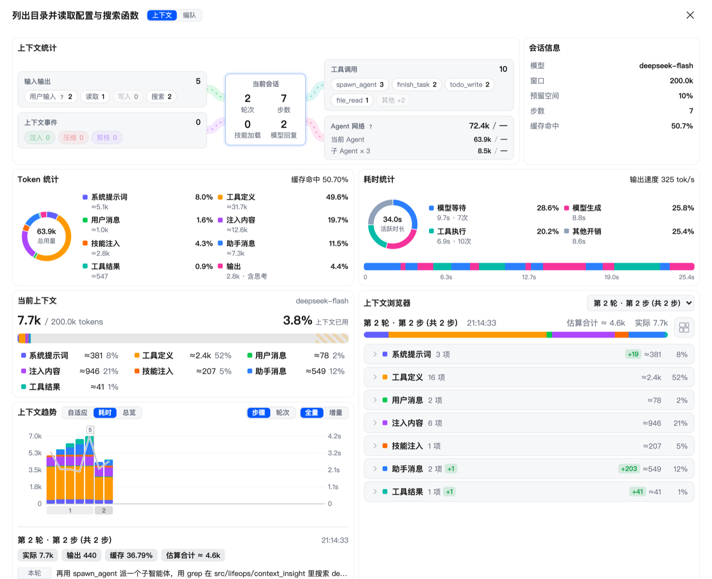
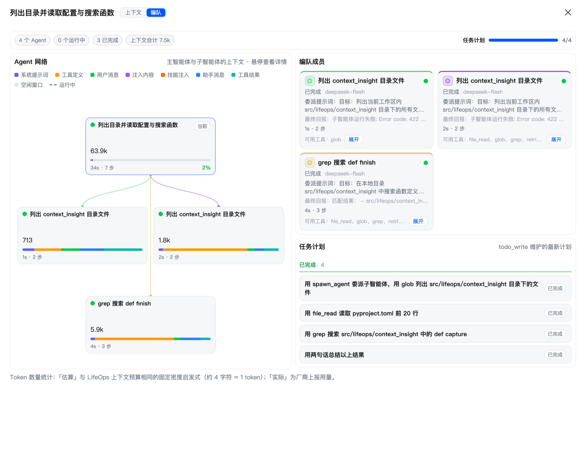
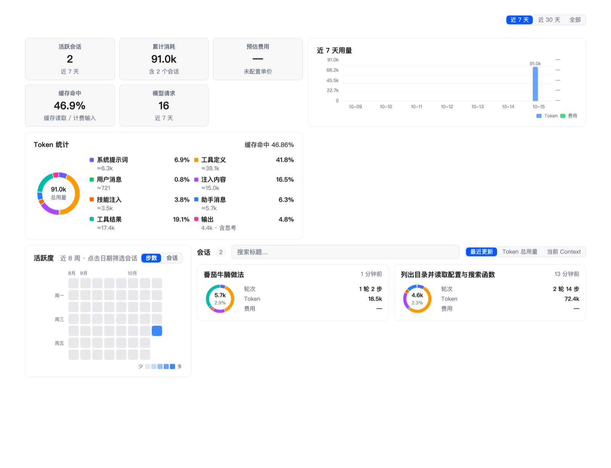

<div align="center">

 

**AI 驱动的生活助手智能体**

[](https://python.org)
[](https://docs.astral.sh/ruff/)

[功能亮点](#功能亮点) · [Web 控制台](#web-控制台) · [智能体能力](#智能体能力) · [快速开始](#快速开始) · [项目结构](#项目结构)

</div>

---

LifeOps 是一个本地优先的 AI 生活助手智能体。它把流式对话、工具调用、Skill 编排、长期记忆、本地 Markdown RAG 和 MCP 工具整合进一个 Web 控制台，让你可以围绕自己的资料、偏好和工作流持续协作。


## 功能亮点

- **流式 AI 对话**：后端通过 SSE 逐 token 返回，前端基于 Element Plus X 实时渲染回复，支持生成中停止；LLM 流式工具参数到齐前会先发送安全预热事件，并兼容需要回传 `reasoning_content` 的思考模式模型。
- **本地 Web 控制台**：Vue 3 + Element Plus + Element Plus X 控制台提供聊天、历史、上下文洞察、知识库和日志入口。
- **会话历史管理**：本地保存会话消息和中文短标题，支持按标题搜索、查看详情和删除会话。
- **「/」命令**：在输入框输入 `/` 弹出命令菜单，支持按命令名或中文名过滤、↑↓ 选择、回车 / Tab 执行、Esc 关闭：`/new` 新建对话、`/search` 搜索对话、`/context` 上下文构成、`/logs` 运行日志、`/regenerate` 重新生成、`/rename` 重命名、`/export` 导出 Markdown、`/plan` 计划模式（见下文）。除 `/plan` 外命令只在前端执行，不发给模型；当前不可用的命令不出现在菜单中。
- **工具过程展示**：参考 DeepSeek Harness，以紧凑中文动作行展示工具调用，支持整轮过程、连续工具分组和单次调用三层折叠；标准/详细两档显示，完整参数、结果与 diff 全部内联查看，运行日志保留原始记录。
- **运行状态栏**：对话输入框上方实时显示本次运行的执行轮次与步骤、生成速率（tok/s）、Token 消耗总量（K/M 缩写）、缓存命中率与环形进度，运行中由 SSE 事件驱动更新，结束时以后端真实 usage 校正，亮暗主题自适应。
- **Skill 工作流**：自动发现项目级和用户级 Skill，按显式 `$skill-name` 或隐式语义匹配按需激活。
- **工具统一注册**：内置工具和 MCP Server 工具使用同一套工具注册模型，每轮请求按相关性动态裁剪暴露给模型的工具。
- **长期记忆**：持续学习会话摘要、用户偏好和知识图谱，并提供记忆搜索、偏好删除、实体删除和低价值记忆清理能力。
- **RAG**：索引本地 Markdown 知识库，混合向量检索、BM25、RRF 与 reranker，让回答能引用你的本地资料。
- **本地知识库管理**：在 DATABASE 页面通过三步向导上传 ZIP，浏览解压目录、预览固定大小或按标题切片，并在后台建立向量与 BM25 索引；完成后重启 LifeOps 加载新知识库。
- **上下文洞察**：每次 LLM 请求都记录上下文构成快照（系统提示 / 工具定义 / 用户消息 / 注入 / 技能 / 助手 / 工具结果）与厂商实际 usage，对话页「上下文」弹窗（与运行日志一致，含上下文 / 编队两个页签）、`/context` 弹窗和「上下文洞察」页可视化构成、趋势、事件、文件活动与子智能体编队。
- **生产级运行时**：每次请求生成 `run_id`，记录结构化 trace、工具策略决策、失败分类和离线 runtime eval，便于审计与回归测试。

## 智能体



### ReAct 推理与工具执行

每次输入都会进入 Agent 调度器。Agent 会先加载必要上下文和相关 Skill，再按“LLM 推理 → 执行工具 → 观察结果 → 继续行动或显式完成”的流程迭代运行，默认最多 50 轮（`LIFEOPS_AGENT_MAX_ITERATIONS` 可调）。简单问答可以直接回答；一旦执行过工具，必须调用下一工具或内部 `finish_task`，不能把普通文本直接视为完成。

工具结果不会简单拼接到回答里，而是进入上下文管理器和历史记录。这样模型可以基于真实执行结果重新判断目标是否满足；同一轮里的多个只读工具（`file_read`、`grep`、`glob` 等）会并行执行以加快信息收集，写入类工具每轮至多一个并在观察完已有结果后串行执行，前端也能通过 Runtime Trace 观察完成决策。

LLM 流式输出工具调用时，Agent 会监听工具名和参数增量：识别工具名后只做无副作用预热，参数可解析为 JSON 后补齐参数元数据；真正执行仍必须等完整 tool call 进入现有策略网关和工具执行流程。

如果流式工具参数拼接后不是合法 JSON，且本轮尚未输出用户可见正文或完整工具调用，Agent 只额外调用一次非流式 LLM 作为协议降级；不猜测修复参数、不用空参数执行工具。降级失败时保留结构化错误，已输出正文的流不会重放。

对于智谱、DeepSeek 等要求在后续请求中回传 `reasoning_content` 的思考模式模型，LifeOps 会在后端历史中保留该协议字段并随下一轮 LLM 请求回传，但不会把模型内部思考内容展示到 Web 消息、搜索结果或 Logging 弹窗中。

### 任务计划与计划闸门

LifeOps 采用内嵌式 Plan-Execute：入口先由复杂度分类器（低温单问 LLM 调用，失败自动降级为简单任务）判定任务是否为多步骤任务。判定为复杂任务时启用**计划闸门**——在通过 `todo_write` 列出计划清单之前，写入类工具（`bash`、`file_create`、`file_replace`、`file_append`）会被系统直接拒绝并附指引，只读探索工具不受限制；模型据此先规划再动笔。计划清单会以"当前任务计划"段落持续注入每轮上下文，要求模型完成一步更新一步、发现计划不合理时整表修订（就地 replan），前端任务计划卡片照常实时展示。整体开关为 `LIFEOPS_AGENT_PLAN_GATE_ENABLED`（默认开启），trace 记录 `task_complexity_decided` 与 `plan_gate_denied` 事件。

### 计划模式

计划模式参考 DeepSeek Harness 的 plan mode，用于"先出方案、人工确认后再动手"的场景：

- **进入与退出**：输入 `/plan` 进入，`/plan off` 退出，`/plan <消息>` 进入并直接发送该消息；输入框上方显示「计划模式」提示条，可点击退出。模式随下一条消息提交（`POST /api/chat` 的 `plan_mode` 字段），按会话持久化在 `conversations.plan_mode`，刷新或重启后保持。
- **规划阶段**：系统上下文追加「计划模式」引导段，要求模型只读探索、写出可直接执行的完整计划；写入类工具（`definition.read_only` 为假，含 `bash`、文件写入、非只读 MCP 工具）被硬拦截，子智能体也只能拿到只读工具。此时跳过复杂度分类，计划闸门让路。
- **提交评审**：模型调用 `exit_plan_mode` 提交以 `# 标题` 开头的 markdown 计划，SSE 发送 `plan_review_required`，对话中出现计划评审卡片：「批准并执行」退出计划模式并在同一次运行内继续执行（已批准的计划满足计划闸门，模型随后用 `todo_write` 拆执行清单）；「继续规划」可附反馈，反馈作为工具错误返回给模型修订后重交；「关闭」、停止运行或超时（`LIFEOPS_AGENT_PLAN_REVIEW_TIMEOUT_SECONDS`，默认 900 秒）则结束本次运行，计划模式保持开启。决策通过 `POST /api/plan-reviews/{request_id}` 提交。
- **开关与 trace**：`LIFEOPS_AGENT_PLAN_MODE_ENABLED`（默认开启）；trace 记录 `plan_mode_changed`、`plan_review_required`、`plan_review_resolved`，规划阶段的拦截复用 `plan_gate_denied`（`reason=plan_mode`）。

### Runtime Trace 与工具策略

Web API 会为每次 `/api/chat` 创建独立 `run_id`，并记录 `run_started`、LLM 调用、检索路由、工具请求、工具策略决策、上下文压缩、完成或失败等 trace event。可通过 `GET /api/runs/{run_id}` 查询一次运行的状态和事件，通过 `GET /api/conversations/{conversation_id}/runs` 查看会话下的运行历史。

工具执行前会经过 `ToolPolicyEngine`。只读工具默认允许，高风险 `bash`、文件写入工具和 MCP 工具默认保守处理；危险命令始终直接拒绝。策略给出 `ask` 决策时进入**人工审批闭环**：SSE 流会先发送 `approval_required` 事件（含参数摘要与原因），聊天输入区上方出现审批卡片，可"允许一次 / 总是允许 / 拒绝"；决策通过 `POST /api/approvals/{request_id}` 提交，Agent 在此期间挂起等待，超时（默认 120s）自动按拒绝处理。"总是允许"会持久化到 `.lifeops/tool-policy.json`（bash 按命令前缀记忆，其他工具按 canonical name），下次同类调用直接放行。`LIFEOPS_TOOL_POLICY_PERMISSION_MODE` 支持 `default`（等待审批）/ `accept_edits`（文件编辑自动放行）/ `yolo`（全部放行，危险命令仍拒绝）。`GET /api/tools/policy` 可查看当前策略摘要。

Runtime 还把 LLM 解析失败、工具失败、策略拒绝、RAG 失败和迭代上限等情况分类写入 trace。离线 eval 覆盖普通问答、危险工具拒绝等核心路径，避免后续 prompt、policy 或 memory 改动破坏基础可靠性。

Runtime 与工具策略默认开启，日常只需关注权限偏好 `LIFEOPS_TOOL_POLICY_PERMISSION_MODE`（`default` / `accept_edits` / `yolo`）。其余参数（`LIFEOPS_RUNTIME_*`、`LIFEOPS_TOOL_POLICY_MODE` / `_PATH` / `_APPROVAL_TIMEOUT_SECONDS`）保持默认即可，需要时参见 `src/lifeops/core/config.py` 中的配置类与默认值；`.env.example` 仅保留常用项。

运行后可直接查询：

```bash
curl http://127.0.0.1:8081/api/runs/<run_id>
curl http://127.0.0.1:8081/api/conversations/<conversation_id>/runs
curl http://127.0.0.1:8081/api/tools/policy
```

### 分层上下文

上下文分为三层：

- `L1`：系统提示、Skill 目录和近期对话，始终保留在上下文中
- `L2`：已激活 Skill 正文、RAG 命中结果和高相关长期记忆
- `L3`：工具执行结果和其他中间产物，压力升高时会卸载、修剪或摘要压缩

这种分层让 LifeOps 可以在长会话中保留稳定身份、近期任务、个人偏好和必要证据，同时控制工具结果带来的上下文膨胀。

### RAG



RAG 系统会把本地 Markdown 知识库索引到 ChromaDB 与 BM25。DATABASE 页面新增知识库时，服务端安全解压 ZIP、展示目录树，并预览首个 Markdown 的切片结果；固定大小支持 150–900 字符，按标题切块时超长章节自动拆分。索引完成后写入完成标识和业务数据库配置，重启时清理未完成导入并加载已完成知识库；覆盖已有知识库前会要求二次确认，失败时恢复旧目录。删除只删除配置，不删除本地文件或索引文件。主 LLM 需要本地资料时调用唯一公开工具 `retrieve_knowledge`，传入工具描述中的顶级 `source`：`source="recipes"` 检索 `dishes/` 菜谱，`source="islamic_culture"` 检索 `伊斯兰文化知识库/`；工具内部再由 `RAGRouter` 分发到对应 Retriever。

返回结果按父 Markdown 文件聚合，并保留证据片段。Markdown 中的本地图片会通过只读资源接口安全展示在前端消息里。




### 记忆管理

LifeOps 会把跨会话信息写入 Docker 管理的 MySQL，包括会话摘要、用户偏好、知识图谱实体与关系、工具/Skill 使用统计和上下文压缩事件。




## Web 控制台

LifeOps 的主要入口是本地 Web 控制台。后端由 FastAPI 提供会话、聊天、Skill、工具、记忆、RAG 资源和数据源管理接口；前端通过 SSE 接收流式回答和工具事件。


### 对话与历史

聊天界面固定在视口内，侧边栏用于新建对话、搜索标题和切换历史会话。新会话的 `done` 事件会先返回基于首条用户消息的即时标题，真实中文短标题在后台生成并写入历史；已有会话如果缺少标题，也会在继续对话后后台补齐。

前端以 [ruoyi-element-ai](https://github.com/element-plus-x/ruoyi-element-ai) 为基础重构，采用 Vue 3、Element Plus 与 Element Plus X：浅灰蓝色侧栏、Conversations 历史列表、居中 Bubble 对话流和 Sender 输入框。聊天、知识库页面均迁移到 Vue，继续接入 LifeOps 的 FastAPI/SSE 接口。工具过程参考 DeepSeek Harness（`1517a4db`，MIT），以“图标 / 中文动作 / 目标摘要 / 状态”的紧凑行展示，分为整轮过程、连续工具分组、单次调用三层。顶栏“标准 / 详细”模式保存在浏览器本地：标准模式正常完成后折叠过程并保留最终回答，详细模式直接显示工具行，单次调用仍手动展开；失败、中断和待审批过程保持可见。文件读取、命令、搜索、知识库、Skill、子智能体和 `todo_write` 使用专属摘要，文件变更内联显示 diff；读取/搜索预览 8 行、diff 预览 9 行，长结果可继续展开、滚动及复制。工具结果 metadata、调用 ID 和结束状态保存在既有 `tool_results` 表中，刷新和历史分页后可恢复；旧记录缺失数据时显示原文或“未完成”。高风险工具触发内联审批卡片（允许一次 / 总是允许 / 拒绝），审批期间输入区自动禁用；生成中可随时停止。完整的工具调用记录和中间信息仍归档到 Logging 弹窗（对话中点击顶栏「运行日志」打开），便于排查。输入框上方常驻一条运行状态栏，横向紧凑地展示本次运行的轮次与步骤（`X 轮 Y 步`）、生成速率（tok/s，滑动窗口估算）、Token 消耗总量（K/M 缩写）、缓存命中率和环形进度（当前轮次 / 50 轮上限）；运行中随 SSE 事件实时刷新，结束后以 `done` 事件携带的真实 usage 校正 Token 与缓存命中率，拿不到时退回前端估算，亮暗主题自适应。空状态提供按时段问候和快捷建议胶囊；快捷键 `⌘/Ctrl + K` 搜索对话，`⌘/Ctrl + Shift + O` 新建对话。对话中最后一轮支持「重新生成」和「编辑后重发」，两者都会调用 `DELETE /api/conversations/{id}/last-turn` 真正删除末轮消息后再生成；回答下方会标注用到的知识库 / 联网来源，新生成的回答还会显示本轮载入的长期记忆条数。助手回答操作栏提供「朗读」按钮，使用浏览器内置语音（Web Speech API）读出回答，代码块会被略过，再点即停止。侧栏历史按「今天 / 昨天 / 7 天内 / 更早」分组，顶栏标题菜单提供重命名（`PATCH /api/conversations/{id}`）、导出整段对话和删除。Markdown 默认禁用原始 HTML 并经过 DOMPurify 清洗；围栏代码块带语言标签与「复制」按钮，并用 highlight.js 对常用语言（bash / python / js / ts / json / sql / yaml / css / xml / diff）做语法高亮；本地图片继续通过后端资源接口展示。模板的 MIT 许可保留在 `web/public/licenses/ruoyi-element-ai.txt`，工具展示的参考说明与 MIT 声明分别见 `web/src/chat/NOTICE.md`、`web/public/licenses/deepseek-harness.txt`。

SSE 保留原有 `token`、`tool_call`、`tool_result` 和 `done` 事件及字段；调用事件补充 `call_id`、`run_id`、迭代序号和已知时间，新增 `tool_status`、`run_started`、`run_finished`、`text_segment`、`answer_start` 支持生命周期与最终回答分段。并行工具按实际完成顺序通知界面，模型历史仍按调用顺序写入。`tool_prepare` 与 `skill_prepare` 继续提供预热状态；现有前端可以继续忽略这些新增事件。`done` 事件自本版本起可携带本次运行累计的真实 `usage`（prompt / completion / total / cached tokens），供前端状态栏展示；最终 token 发出后，`done` 会尽快关闭连接，短标题落库和长期记忆学习会通过后台任务继续完成。



以上 Web 与 Logging 截图使用浏览器验收的隔离示例数据。

### 上下文洞察

上下文洞察移植自 [dsh-context](https://github.com/bowenliang123/dsh-context)（Apache-2.0），把它在 DeepSeek Harness 上的效果做成了 LifeOps 的原生能力，样式表与组件结构尽量照搬。

- **记录**：`Agent` 每次调用 LLM 前，把实际发送的请求拆成元素（系统提示各分段、每个工具 schema、每条消息），按七类估算 token，写入 `context_snapshots`；元素内容按哈希去重存入 `context_blobs`。响应返回后补写厂商 usage（含缓存命中）、首 token 时间与耗时。子智能体（`spawn_agent`）的每次请求也会记录，并挂在主智能体下。流式请求通过 `stream_options.include_usage` 拿 usage，不支持该参数的厂商可设 `LLM_STREAM_USAGE=false`。
- **对话页抽屉**：顶栏「上下文」按钮打开，分「上下文 / 编队」两页。上下文页包含流向统计、Token 与耗时环图、当前构成（含预留空间遮罩）、每次请求一根柱子的趋势图（步骤 / 轮次、全量 / 增量、自适应、耗时曲线、总览带状图）、步骤简报、上下文浏览器（任选一步按类别展开到原文，与上一步对比增减，矩形树图）、上下文事件（压缩 / 剪枝 / 技能注入 / 模型切换 / 计划）和文件活动（读写搜索聚合、行数增删、跳转到对应工具结果）。编队页展示主智能体与子智能体的网络图、成员卡片（委派提示词、最终回报）和 `todo_write` 任务计划。运行中抽屉每 2 秒刷新。
- **`/context`**：在输入框发送 `/context`（或从「/」命令菜单选择）只在前端打开构成弹窗，不发给模型。
- **上下文洞察页**：侧栏入口，按 7 天 / 30 天 / 全部统计活跃会话、累计 Token、预估费用、缓存命中、近 7 天用量、汇总构成、8 周活跃热力图和会话卡片；点击卡片打开该会话及其抽屉。
- **费用**：配置 `LIFEOPS_CONTEXT_PRICE_INPUT_PER_M` / `_OUTPUT_PER_M` / `_CACHE_PER_M`（元/百万 token）后显示估算费用，未配置时不估算。
- **接口**：`GET /api/conversations/{id}/context`、`/context/files`、`/context/fleet`，`GET /api/context/snapshots/{snapshot_id}`，`GET /api/context/overview?range=7d|30d|all`。功能上线前的旧会话没有快照，不做回填。







### Skills

LifeOps 按 Agent Skills 标准扫描项目级 `.agents/skills/` 与用户级 `~/.agents/skills/`，每个 Skill 是包含 `SKILL.md` 的独立目录，并在对话中根据显式 `$skill-name` 或隐式语义匹配按需激活。

Skill 系统启用时，Agent 会额外暴露只读低风险内部工具 `activate_skill`。模型可通过该伪工具请求激活目录中的 Skill；流式阶段只预读取并校验 Skill，最终工具执行成功后才把完整 Skill 正文注入 L2 上下文并写入 Skill 使用 trace。

### Tools 与 MCP

内置工具包括命令执行（支持后台任务：长时命令 `run_in_background` 启动后用 `bash_output` 读取输出、`bash_kill` 终止；超时自动 kill，输出超限保留头尾）、文件读取、文件创建/替换/追加、代码搜索（`grep` 正则匹配与 `glob` 文件查找）、网页搜索和本地知识库检索。文件编辑有安全网保护：修改已有文件前必须先用 `file_read` 读过该文件（会话级 `FileEditGuard` 强制），`file_replace` 的 `old_text` 必须在文件中唯一，编辑结果以 unified diff 写入工具结果 metadata 并可在 Logging 弹窗查看。工具参数 schema 会保留 `minLength`、`minimum`、`maximum`、`enum`、`pattern`、`additionalProperties: false` 等约束，便于模型调用校验。

Agent 运行时不需要区分工具来源。内置工具、MCP 工具和内部 Skill 伪工具都会注册到统一工具表中，执行层始终保留完整 registry，执行结果再写入上下文和 Logging。`/api/tools` 仍返回完整工具清单，便于管理和调试。

发送给 LLM 的 `tools` 数组会在每轮请求前动态裁剪到最多 20 个：核心内置工具优先保留，MCP 工具会按用户输入、已激活 Skill、Skill `allowed-tools`、工具名/描述和常见 server 领域词做确定性匹配，只暴露本轮相关的 MCP 工具。这样可以在保留完整 MCP 能力的同时减少模型工具选择噪声。

每轮 LLM 请求还会估算 system、历史消息和工具 schema 的 token 预算，超限时裁剪最旧历史并压缩当前运行中的工具输出；无法安全压缩时返回 `context_error` 并将运行标记为失败。MCP 发送给模型的 function name 只使用合法 wire name（例如 `mcp_github_search_repositories`），策略、日志和路由仍保留 `mcp.github.search_repositories` canonical name。

除了手写 `LIFEOPS_MCP_SERVERS` JSON，LifeOps 也支持 `LIFEOPS_MCP_PRESETS` 启用无需 API Key 的基础 MCP 能力。推荐基础组合是 `context7,playwright,memory,sequential_thinking,filesystem`，分别用于库文档查询、浏览器自动化、本地记忆、结构化推理和受限文件访问。已有同名手写 Server 会优先于预设，不会被覆盖。


## 快速开始

```bash
python3 -m venv .venv
source .venv/bin/activate
python -m pip install -e ".[dev]"
cp .env.example .env   # 填写 LLM_API_KEY，核对模型与端点；其他常用项按需取消注释
lifeops-web
```

Linux 上如需避免安装 CUDA 版 PyTorch，请在安装项目依赖前先从 CPU wheel 源安装：

```bash
python -m pip install torch==2.11.0 --index-url https://download.pytorch.org/whl/cpu --extra-index-url https://pypi.org/simple
```

需要启用 Google Workspace MCP 时，额外安装 `workspace` 依赖组：`python -m pip install -e ".[workspace]"`。

另开一个终端启动前端：

```bash
cd web
npm install
npm run dev
```

默认后端地址为 `http://127.0.0.1:8081`，前端地址为 `http://127.0.0.1:5173`。

后端监听地址可通过环境变量覆盖（前缀 `LIFEOPS_WEB_`）：

```bash
# .env
LIFEOPS_WEB_HOST=127.0.0.1
LIFEOPS_WEB_PORT=8082
```

修改端口后必须同步前端 `web/.env.local` 的 `VITE_API_URL`（例如 `VITE_API_URL=http://127.0.0.1:8082`），两者不一致时页面请求会报 `Failed to fetch`。本机 `.env` 使用 `8082`，因为 `8081` 已被其他项目的前端 dev server 占用。

### 使用 Docker Compose 管理后端、MySQL 和 Chroma

在 Docker Desktop 已启动、`.env` 已填写 LLM 配置及两个独立的 MySQL 随机密码后运行：

```bash
docker compose build
# 已有 SQLite 数据时先执行下文迁移步骤，再启动新版后端。
docker compose up -d
docker compose ps
docker compose logs -f backend
```

后端地址固定为 `http://127.0.0.1:8082`，前端 `web/.env.local` 使用
`VITE_API_URL=http://127.0.0.1:8082`，前端继续通过 `npm run dev` 运行。
Compose 会覆盖容器监听地址为 `0.0.0.0`，宿主机仅向本机开放端口。
服务异常退出后自动重启；Mac 重启后需先启动 Docker Desktop。

会话、长期记忆、知识库配置、运行轨迹和上下文快照保存在 MySQL 8.4 的
`mysql-data` 命名卷中。后端等待数据库健康后启动，连接失败时直接报错，
不会回退写入 SQLite。MySQL 仅向本机开放 `127.0.0.1:3307`，容器内使用 `mysql:3306`。
向量由独立的 Chroma 1.5.7 服务管理，保存在 `chroma-data` 命名卷的 `/data` 中；
后端通过 `chroma:8000` 连接，宿主机仅开放 `127.0.0.1:8004`。后端等待两个数据库健康后启动。
知识库原文、BM25/父文档/切片缓存和审批文件仍保存在宿主机 `.lifeops/`；已有 `models/`
只读挂载复用。首次使用需先准备完整模型文件，模型缓存只读，不在运行中下载到该目录。
Linux 依赖使用 CPU 版 PyTorch，不安装 CUDA。
项目目录挂载到 `/workspace`，项目 Skill、Filesystem MCP 和 Agent 文件工具可访问该目录；
其他 Mac 目录（例如 Obsidian vault）需要通过本地 Compose 覆盖文件显式挂载。
Agent 的 shell 命令在 Linux 容器内执行，修改源码后需重新构建镜像。

镜像预装 Node.js、Chromium、现有 MCP 程序及 GitHub MCP 可执行文件，
`docker/entrypoint.py` 在启动时适配 `.env` 中的 MCP 命令，不需要挂载 Docker socket，
不改写原有 `.env`。Google 凭据默认存放在 `google-credentials` 卷中；迁移已有凭据时，
可通过忽略提交的 `compose.override.yaml` 把宿主机凭据目录挂载到
`/var/lib/lifeops/google-mcp`，授权范围沿用 `.env`。

MCP 参数适配支持 `type: ["boolean", "null"]` 等联合类型，
避免 Sequential Thinking 等工具因可空字段注册失败；必填约束仍然保留。

```bash
docker compose restart backend    # 重启后端
docker compose up -d --build      # 更新源码后重建并启动
docker compose down              # 停止，保留挂载的数据与命名卷
```

容器日志自动轮转，最多保留 3 个 10 MB 文件。`healthcheck` 检查知识库 API，
健康检查失败用于显示状态；自动重启策略仅在进程退出时生效。
本机直接运行后端时，`LIFEOPS_DATABASE_URL` 指向本机的 MySQL 端口；
本机的 Chroma 参数为 `LIFEOPS_RAG_CHROMA_HOST=127.0.0.1`、`LIFEOPS_RAG_CHROMA_PORT=8004`；
Compose 自动覆盖为内部地址。`LIFEOPS_RAG_CHROMA_PATH` 在服务模式下只保存 BM25 等本地缓存。
HOST 留空才使用旧嵌入式 Chroma；已配置服务时不会因连接失败而回退创建本地向量库。
消息搜索使用 MySQL 的字面子串查询，支持中文、单字和标点；
SQLite FTS5 的派生索引无需迁移。

已有 SQLite 数据可在停止后端后迁移，目标必须为空库：

```bash
docker compose up -d mysql --wait
docker compose stop backend
docker compose run --rm --no-deps backend python -m lifeops.storage.mysql_migration \
  --sqlite /app/.lifeops/conversations.db \
  --report /workspace/.codex/mysql-migration-report.json
docker compose up -d --wait
```

迁移工具检查全部 22 张数据表的行数和全部字段 SHA-256（包括二进制向量），
提交后重新连接复核；目标已有不同数据时拒绝覆盖。旧 JSONL 不会在 MySQL 启动时重新导入。
旧库的删除应在接口读写、MySQL 导出及恢复校验通过之后执行；知识库与 Chroma 索引保留。
SQLite 仅保留为兼容测试与旧数据迁移的实现。

导出 MySQL 备份（备份包含个人数据，请保存到本机受限目录）：

```bash
umask 077
docker compose exec -T mysql sh -c 'MYSQL_PWD="$MYSQL_ROOT_PASSWORD" mysqldump -u root --single-transaction --hex-blob --no-tablespaces --set-gtid-purged=OFF "$MYSQL_DATABASE"' > lifeops-mysql.sql
```

已有嵌入式 Chroma 可在停止后端后直接迁移向量，无需重新下载模型或计算 embedding：

```bash
docker compose stop backend
docker compose up -d chroma --wait
docker compose run --rm --no-deps backend python -m lifeops.rag.chroma_migration \
  --source /app/.lifeops/chroma --backup-dir /workspace/.codex/chroma-export
docker compose up -d --wait
```

迁移要求目标 Chroma 为空；工具先生成受限权限的 `collection-*.jsonl.gz` 导出备份，
再逐条比较 ID、正文、元数据、URI 与 float32 向量 SHA-256，并保留集合索引参数。
恢复到空服务时使用 `--restore /workspace/.codex/chroma-export` 代替 `--source` 和 `--backup-dir`。
验证后可把旧 `chroma.sqlite3` 与 UUID 向量目录移出活动索引目录归档，
必须保留三个 `.pkl` 缓存及 `index_state.json`。Chroma 自身的数据卷内部仍使用 SQLite/HNSW，
它与 MySQL 业务库用途不同。部署方式见 [Chroma 官方 Docker 文档](https://docs.trychroma.com/guides/deploy/docker)。

索引重建只删除当前集合，保留其他集合和本地文件。向量按批次写入；增量删除失败会报错，
避免静默留下旧向量。同步发现集合缺失或向量数量与切片缓存不符时，会重新生成索引。

常用开发命令：

```bash
python -m pytest tests/ -v
python -m pytest tests/evals -v
python -m ruff check src/ tests/

cd web
npm run build
npm test                 # 消息事件和分页定向测试
npm run test:ui          # 启动前端后，串行浏览器检查（隔离 HTTP/SSE 桩）
```

如需重建本地 Markdown RAG 索引：

```bash
python -m lifeops.rag.index --rebuild
```

## 项目结构

```text
lifeops/
├── src/lifeops/
│   ├── agent.py                 # Agent 核心调度器
│   ├── context_insight/         # 上下文快照记录与洞察查询
│   ├── history.py               # 本地会话历史
│   ├── core/                    # 配置与分层上下文
│   ├── llm/                     # OpenAI 兼容 LLM 客户端
│   ├── memory/                  # 长期记忆、偏好和知识图谱
│   ├── rag/                     # Markdown RAG 索引与检索
│   ├── runtime/                 # run/trace、工具策略和失败分类
│   ├── skills/                  # Skill 发现、匹配和加载
│   ├── tools/                   # 内置工具与 MCP 适配
│   └── web/                     # FastAPI 本地 Web API
├── web/                         # Vue 3 + Vite Web 控制台（web/src/context 为上下文洞察）
├── tests/                       # pytest 测试套件
├── assets/                      # README Logo 与截图素材
├── .agents/skills/              # Agent Skills 标准 Skill 目录
└── .lifeops/                    # 本地知识库、历史和索引数据（旧 Skill 备份不再自动读取）
```

## Star History

<a href="https://www.star-history.com/?repos=DarkFanta3y%2Flifeops&type=date&logscale=&legend=top-left">
 <picture>
   <source media="(prefers-color-scheme: dark)" srcset="https://api.star-history.com/chart?repos=DarkFanta3y/lifeops&type=date&theme=dark&logscale&legend=top-left" />
   <source media="(prefers-color-scheme: light)" srcset="https://api.star-history.com/chart?repos=DarkFanta3y/lifeops&type=date&logscale&legend=top-left" />
   
 </picture>
</a>

## License

MIT
